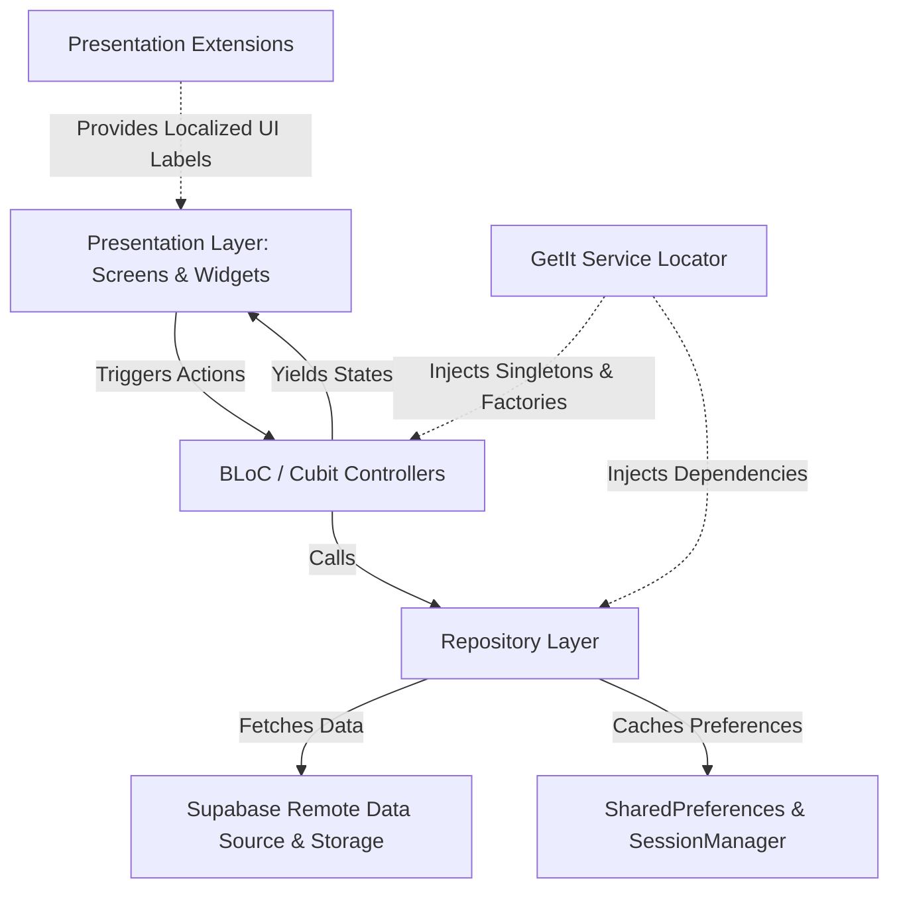

# 🩺 Doctor Hunt — Smart Healthcare & Doctor Appointment Booking App

<p align="center">
  
</p>

<p align="center">
  <strong>An enterprise-grade, production-ready telemedicine and doctor appointment booking platform built with Flutter, Supabase, BLoC, and Clean Architecture.</strong>
</p>

<p align="center">
  <a href="https://flutter.dev/"></a>
  <a href="https://dart.dev/"></a>
  <a href="https://supabase.com/"></a>
  <a href="https://bloclibrary.dev/"></a>
  <a href="https://pub.dev/packages/go_router"></a>
  <a href="https://pub.dev/packages/slang"></a>
  <a href="#-automated-testing--code-quality"></a>
  <a href="LICENSE"></a>
</p>

---

## 📌 Table of Contents

- [About The Project](#-about-the-project)
- [Key Features](#-key-features)
  - [Patient Experience](#-patient-experience)
  - [Admin Experience](#-admin-experience)
  - [Authentication & Security](#-authentication--security)
  - [Internationalization & RTL Support](#-internationalization--rtl-support)
- [Architecture & Design Principles](#-architecture--design-principles)
- [Automated Testing & Code Quality](#-automated-testing--code-quality)
- [Screenshots & UI Showcase](#-screenshots--ui-showcase)
- [Folder Structure](#-folder-structure)
- [Tech Stack & Dependencies](#-tech-stack--dependencies)
- [Engineering Guidelines & Coding Standards](#-engineering-guidelines--coding-standards)
- [Getting Started](#-getting-started)
  - [Prerequisites](#prerequisites)
  - [Installation & Setup](#installation--setup)
  - [Environment Variables](#environment-variables)
  - [Code Generation](#code-generation)
- [Roadmap](#-roadmap)
- [Contributing](#-contributing)
- [Author & Acknowledgments](#-author--acknowledgments)
- [License](#-license)

---

## 🩺 About The Project

**Doctor Hunt** is an enterprise-grade mobile healthcare and telehealth application that seamlessly connects patients with verified medical practitioners. Built with a **Feature-First Clean Architecture**, Doctor Hunt delivers exceptional UI responsiveness, robust state handling via **BLoC/Cubit**, end-to-end type safety, and real-time database synchronizations powered by **Supabase**.

The system addresses both sides of medical care management:
1. **For Patients:** Effortless specialist discovery, real-time consultation slot reservation (with double-booking prevention), favorite doctor persistence, and comprehensive appointment tracking.
2. **For Clinic Admins & Doctors:** Complete operational portal for managing doctor rosters, working hours, real-time availability slots, and patient booking statuses.

---

## ✨ Key Features

### 👤 Patient Experience
- **Interactive Onboarding:** Clean carousel introducing telehealth consultation and medical discovery.
- **Dynamic Home Dashboard:** Live doctor availability indicators, popular specialists, medical category filters, and debounced quick search.
- **Doctor Discovery & Filtering:** Filter specialists by field (Cardiology, Pediatrics, Neurology, etc.), rating, and consultation fees.
- **Detailed Physician Profiles:** Comprehensive doctor bios, consultation pricing, patient reviews, and practice credentials.
- **Smart Appointment Booking:** Dynamic time slot selector that cross-references confirmed appointments to eliminate double-booking conflicts.
- **Patient Appointment Center:** Tabbed views (Upcoming, Completed, Canceled) with direct navigation to detailed status screens and cancellation workflows.
- **Patient Drawer Navigation:** Quick access to Profile, My Appointments, Medical Records, Payments, Medicine Orders, Help Center, Settings, and Sign Out.
- **User-Scoped Favorites:** Save and unfavorite preferred doctors with persistent local and cloud state tied to the authenticated user ID.

### 🛡️ Admin Experience
- **Physician Catalog Management:** Create, view, update, and manage doctor profiles with image uploading via Supabase Storage.
- **Availability & Slot Scheduler:** Configure weekly working schedules, shift hours, and available appointment booking intervals.
- **Appointment Control Dashboard:** Monitor patient bookings in real time, review consultation requests, and update statuses (Confirm, Cancel, Complete).
- **Clinic Administration:** Manage clinic operational settings and administrative profiles.

### 🔐 Authentication, Route Guards & Security
- **Multi-Role System:** Strongly-typed role separation (`UserRole.patient` and `UserRole.admin`) via Dart enums.
- **Email & Password Authentication:** Form-validated account creation, login, and error-resilient authentication flows.
- **Google OAuth Sign-In:** One-tap social authentication with Google.
- **Session Management & Route Guards:** Centralized [`SessionManager`](lib/core/services/session_manager.dart) and GoRouter `redirect` guards preventing unauthorized access to role-specific screens.
- **Safe Deep Linking:** Route builders implement safe fallbacks without risky force-unwrapping (`!`).

### 🌐 Internationalization & RTL Support
- **Dual Language Support:** Full English (`en`) and Arabic (`ar`) translations.
- **Compile-Time Safe i18n:** Powered by [`slang`](https://pub.dev/packages/slang) with structured JSON locales in `assets/i18n/`.
- **Reactive Language Switching:** Dynamic live switching via `LocaleSettings.setLocale()` that updates all active screens and inverts layout directions for native RTL Arabic readability.

---

## 🏗️ Architecture & Design Principles

Doctor Hunt implements **Clean Architecture** paired with a **Feature-First modular structure**:



### Architectural Highlights
- **Strict Layer Separation:** UI widgets never communicate directly with Supabase or repositories; all interactions pass through dedicated Cubits.
- **Domain Model Purity:** Domain entities and data models remain purely representational. Localized display labels and UI formatting are decoupled into presentation extensions (`presentation/extensions/`).
- **Centralized Dependency Injection (`GetIt`):** All repositories, services, session managers, and Cubits are registered in [`lib/core/di/service_locator.dart`](lib/core/di/service_locator.dart) (`sl`).
- **Debounced Live Search:** Centralized [`Debouncer`](lib/core/utils/debouncer.dart) utility (~300ms) integrated into [`CustomTextField`](lib/core/widgets/custom_text_field.dart) prevents request spamming and unnecessary UI filtering.
- **Consistent Design System:** Zero hardcoded colors or text styles; strictly utilizes [`AppColors`](lib/core/themes/app_colors.dart) and [`AppTextStyles`](lib/core/themes/app_text_styles.dart).
- **Performance Optimization:** Leverages `MediaQuery.sizeOf(context)` and `MediaQuery.paddingOf(context)` to eliminate unnecessary frame rebuilds.

---

## 🧪 Automated Testing & Code Quality

Doctor Hunt features an automated test suite comprising **200 tests** covering unit, repository, cubit, and widget layers with a **100% pass rate**:

```plaintext
00:10 +200: All tests passed!
```

### Test Coverage Breakdown:
| Test Category | Scope & Modules Tested |
| :--- | :--- |
| **Unit & Cubit Tests** | `AuthCubit`, `AdminAppointmentsCubit`, `PatientAppointmentsCubit`, `PatientHomeCubit`, `PatientDoctorsCubit` |
| **Repository Tests** | `AuthRepository`, `AdminRepository`, `PatientAppointmentsRepository`, `PatientDoctorsRepository` |
| **Domain Model Tests** | Serialization (`fromJson`/`toJson`), equality checks (`Equatable`), status transitions, and presentation extensions |
| **Service & Core Tests** | `SessionManager` session persistence, `Debouncer` timing logic, GoRouter route guards, and `AppLogger` formatting |
| **Widget & UI Tests** | `PatientMenuDrawer`, dialog interactions (`RateDoctorDialog`), cards, buttons, and custom inputs |

To run the complete test suite:
```bash
flutter test
```

To run static analysis:
```bash
flutter analyze
# 0 issues found!
```

---

## 📱 Screenshots & UI Showcase

| Onboarding | Doctor Discovery | Doctor Details |
| :---: | :---: | :---: |
|  |  |  |

| Featured Doctors | Live Consultation | Popular Specialists |
| :---: | :---: | :---: |
|  |  |  |

---

## 📂 Folder Structure

```plaintext
lib/
├── core/
│   ├── constants/             # App constants, Supabase & Google Client IDs
│   ├── di/                    # Centralized GetIt service locator (service_locator.dart)
│   ├── enums/                 # Enums: UserRole, DoctorFilter, SortOption
│   ├── errors/                # Custom Exceptions & Failures
│   ├── extensions/            # Context, String, and Widget helper extensions
│   ├── localization/          # LocaleHelper & Slang bootstrap utilities
│   ├── router/                # GoRouter setup, Route Guards & route definitions
│   ├── services/              # SessionManager, SupabaseStorageService
│   ├── themes/                # AppColors, AppTextStyles & ThemeData
│   ├── utils/                 # Debouncer, AppLogger, image formatters
│   └── widgets/               # CustomButton, CustomTextField, LogoHeader
│
├── features/
│   ├── admin/                 # Admin Module
│   │   ├── data/              # Admin models, repositories, mock/live sources
│   │   └── presentation/      # Admin screens, cubits, widgets, extensions
│   ├── common/                # Shared Cross-Cutting Features
│   │   ├── auth/              # Login, Register, Forgot Password
│   │   ├── choose_role/       # Role-selection controller & screen
│   │   ├── onboarding/        # Introduction walkthrough
│   │   ├── main/              # Bottom navigation root container
│   │   └── splash/            # Splash screen & session gatekeeper
│   └── patient/               # Patient Module
│       ├── appointments/      # Booking management, status tabs, extensions
│       ├── doctors/           # Doctor search, reviews, slots, live consultation
│       └── home/              # Patient dashboard, favorites, drawer menu
│
├── generated/
│   └── i18n/                  # Slang generated translation files (strings.g.dart)
└── main.dart                  # App bootstrap, provider setup & initializations

test/                          # Comprehensive 200 automated tests
├── core/                      # Tests for Debouncer, SessionManager, Guards
├── features/                  # Unit, Cubit, Repo & Widget tests
└── helpers/                   # Test doubles, mocks, and test helpers
```

---

## 🛠️ Tech Stack & Dependencies

| Category | Technology / Package | Purpose |
| :--- | :--- | :--- |
| **Framework** | [Flutter](https://flutter.dev) | Cross-platform UI toolkit |
| **Language** | [Dart](https://dart.dev) (v3+) | Strongly-typed client language |
| **State Management** | [flutter_bloc](https://pub.dev/packages/flutter_bloc) & [bloc](https://pub.dev/packages/bloc) | Predictable, unidirectional state management |
| **Backend & Cloud** | [supabase_flutter](https://pub.dev/packages/supabase_flutter) | PostgreSQL database, Auth, and Storage |
| **Authentication** | [google_sign_in](https://pub.dev/packages/google_sign_in) | Google OAuth integration |
| **Declarative Routing** | [go_router](https://pub.dev/packages/go_router) | Deep-linking & programmatic route guards |
| **Internationalization** | [slang](https://pub.dev/packages/slang) & `slang_flutter` | Compile-time safe translations (AR & EN) |
| **Dependency Injection** | [get_it](https://pub.dev/packages/get_it) | Centralized service locator pattern |
| **Value Equality** | [equatable](https://pub.dev/packages/equatable) | Value-based equality comparisons |
| **UI Styling** | [google_fonts](https://pub.dev/packages/google_fonts), [flutter_svg](https://pub.dev/packages/flutter_svg) | Typography and vector assets |
| **Local Cache** | [shared_preferences](https://pub.dev/packages/shared_preferences) | Persistent key-value storage |
| **Testing Suite** | `mocktail`, `bloc_test`, `flutter_test` | Unit, Repository, Cubit, and Widget testing |

---

## 📜 Engineering Guidelines & Coding Standards

This repository adheres to strict architecture standards documented in:
- 📖 [**PROJECT_INSTRUCTIONS.md**](PROJECT_INSTRUCTIONS.md): Comprehensive architecture guide, layer separation rules, testing standards, and AI audit workflow.
- ⚙️ [**.cursorrules**](.cursorrules): System instructions for AI coding assistants (Cursor, Antigravity, GitHub Copilot).

---

## 🚀 Getting Started

Follow these steps to run the project on your local machine:

### Prerequisites
- [Flutter SDK](https://docs.flutter.dev/get-started/install) (`^3.12.0` or higher)
- [Dart SDK](https://dart.dev/get-dart)
- Android Studio / VS Code with Flutter extension
- An active [Supabase](https://supabase.com) account & project

### Installation & Setup

1. **Clone the repository:**
   ```bash
   git clone https://github.com/samymahmoud22/doctor-hunt.git
   cd doctor-hunt
   ```

2. **Install project dependencies:**
   ```bash
   flutter pub get
   ```

3. **Configure Environment Variables:**
   Doctor Hunt supports Dart environment flags. You can configure your own Supabase project credentials:
   ```bash
   flutter run \
     --dart-define=SUPABASE_URL=YOUR_SUPABASE_PROJECT_URL \
     --dart-define=SUPABASE_ANON_KEY=YOUR_SUPABASE_ANON_KEY \
     --dart-define=GOOGLE_WEB_CLIENT_ID=YOUR_GOOGLE_CLIENT_ID
   ```
   *(Fallback configurations are defined in [supabase_constants.dart](lib/core/constants/supabase_constants.dart) for quick local development).*

### Code Generation

Doctor Hunt uses code generators for translations and routes. If you update translation strings in `assets/i18n/`:

- **Generate Slang translations:**
  ```bash
  dart run slang
  ```

---

## 🗺️ Roadmap

- [x] Patient discovery, search debouncer, and physician profiles.
- [x] Real-time appointment booking system with slot conflict validation.
- [x] Clinic admin doctor roster management and availability scheduler.
- [x] Full Arabic (RTL) & English localization with live switching.
- [x] Supabase Authentication, Storage, and Google OAuth.
- [x] GoRouter Route Guards & persistent session management.
- [x] Comprehensive 200 automated unit, widget, and cubit tests.
- [ ] Push notifications for appointment reminders (Firebase Cloud Messaging).
- [ ] In-app video consultations (WebRTC / Agora integration).
- [ ] Payment gateway integration (Stripe / Paymob).
- [ ] Digital prescription downloads & laboratory report attachments.

---

## 🤝 Contributing

Contributions are what make the open-source community an amazing place to learn, inspire, and create. Any contributions you make are **greatly appreciated**.

1. Fork the Project
2. Create your Feature Branch (`git checkout -b feature/AmazingFeature`)
3. Commit your Changes (`git commit -m 'feat: Add some AmazingFeature'`)
4. Push to the Branch (`git push origin feature/AmazingFeature`)
5. Open a Pull Request

---

## 👨‍💻 Author & Acknowledgments

Developed by **Samy Mahmoud**  
- GitHub: [@samymahmoud22](https://github.com/samymahmoud22)
- Email: samymahmoud2060@gmail.com

---

## 📄 License

This project is open-source and licensed under the [MIT License](LICENSE).
